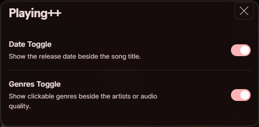

# Playing++

Release dates and clickable genres in Spotify’s now-playing bar.


- Shows the release date beside the song title.
- Adds genres beside the audio quality label, or below the title.
- Click a genre to find a matching playlist.
- Long genre lists scroll when you hover over them.
- Turn dates and genres on or off separately from **Profile menu → Playing++**.

## Install

Requires [Spicetify](https://spicetify.app/docs/getting-started/) and Spotify desktop.

**Marketplace:** Search for **Playing++** in Extensions and click Install. If it has not appeared yet, use the manual steps below.

**Manual:** Download [playing-plus-plus.js](playing-plus-plus.js), place it in the `Extensions` folder inside your Spicetify config directory (`spicetify config-dir`), then run:

```powershell
spicetify config extensions playing-plus-plus.js
spicetify apply
```

## Settings

Open your profile picture menu and choose **Playing++**. **Date Toggle** and **Genres Toggle** are saved automatically.



## About the data

The date is for the Spotify album or edition currently playing; a remaster may have a different date from the original release.

Genres come from MusicBrainz recording tags, with Spotify artist genres, MusicBrainz artist tags, and Apple catalog genres as fallbacks. Artist genres can describe the artist more broadly than the individual song. Hover over the details to see the source. Some songs have no available genres.

MusicBrainz receives the track’s ISRC or title and artist for matching. The Apple fallback receives the title and artist. External requests do not include Spotify credentials. Lookups are rate limited and cached in memory until reload. No API key is needed.

Local files, podcasts, and ads are unsupported. Spotify layout or API changes may require updates.

## Development

No build step or dependencies. With Node.js 20 or later:

```sh
npm test
npm run check
```
